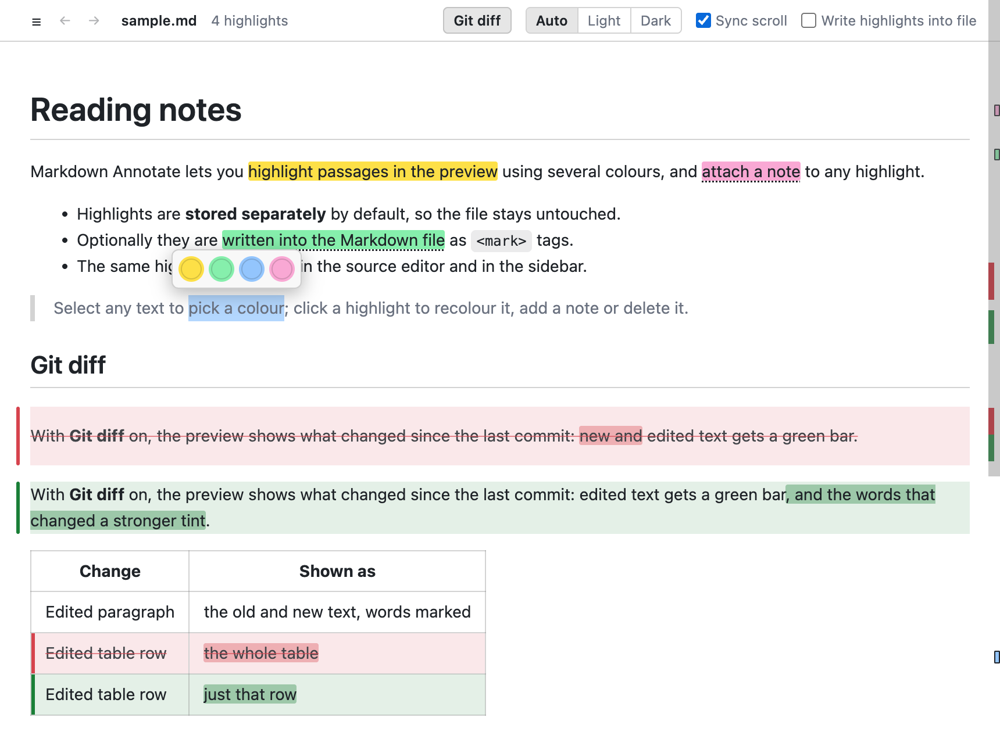
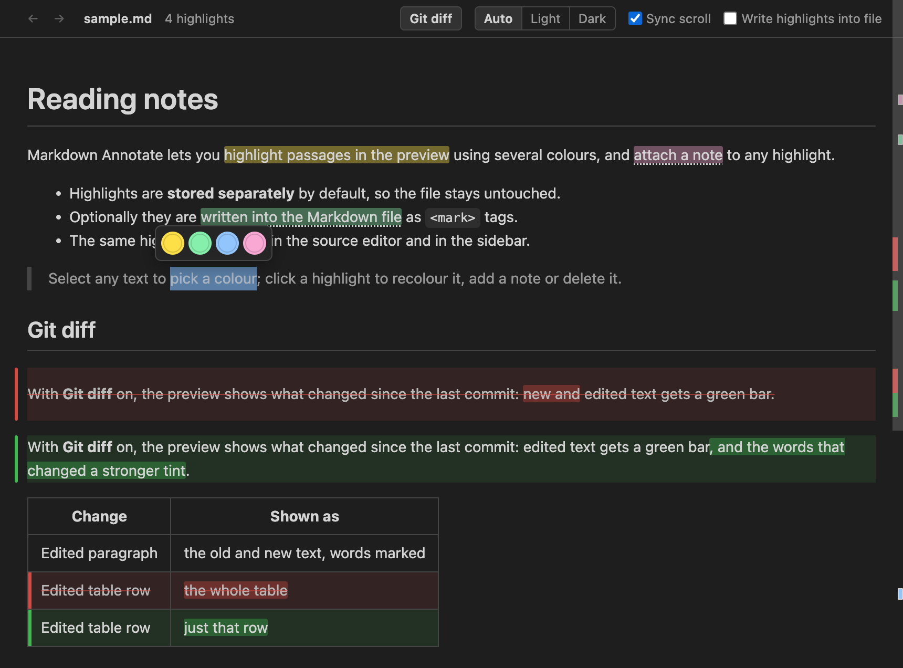

# Markdown Annotate

Highlight a Markdown preview in several colours, attach notes, and — if you want — write the highlights into the Markdown file itself.



This README has a few real highlights written into it: open it with **Open Annotatable Preview** to see them, with their notes, in the preview and on its scrollbar.

## Features

### Highlight the preview

Run **Markdown Annotate: Open Annotatable Preview to the Side** (`Cmd+Alt+H` / `Ctrl+Alt+H`, or the colour icon in the editor title bar). <mark data-hl="yellow" data-hl-id="rdm001" style="background-color:#fde047;color:#1f2328">Select any text and a small colour picker appears</mark>; click a colour or press `1`–`9`.

Selections can span formatting, links, list items, table cells and paragraphs.

### Recolour, annotate, delete

Every highlight is also marked on the preview's scrollbar in its colour, so you can see where they are in a long document. Highlights with a note get an outlined mark.

Click a highlight to open its popover:

- pick another colour
- add a note (shown on hover, in the sidebar and in exports; `Cmd/Ctrl+Enter` saves)
- **Show in source** jumps to the line in the editor
- **Delete**

`Cmd/Ctrl+click` anywhere in the preview also jumps to that line in the source.

### Syntax highlighting

Fenced code blocks with a language (```` ```ts ````, ```` ```python ````, …) get syntax colours from GitHub's light and dark palettes, following the preview theme. Bundled languages: Bash/Shell, C, C++, C#, CSS (also used for SCSS/Less), Diff, Dockerfile, Go, INI/TOML, Java, JavaScript, JSON, Kotlin, Makefile, Markdown, PHP, PowerShell, Python, Ruby, Rust, SQL, Swift, TypeScript, HTML/XML and YAML. Fences without a language are auto-detected among these; if the guess is weak (prose, file trees, one-line shell commands) the block stays plain, so tag those, e.g. ```` ```bash ````. Other languages show as plain text. Shell blocks (`bash`, `sh`, `zsh`, `shell`) also colour command names and `--flags`, as Prism does; `console` blocks with `$ ` prompts are shown as terminal sessions. Highlighting inside code works as usual.

### Light or dark

The **Auto / Light / Dark** switch in the preview header either follows your VS Code theme or forces a light or dark preview, e.g. a light page for reading while the editor stays dark. The choice is remembered (`markdownAnnotate.previewTheme`), and **Switch Preview Theme** cycles it from the Command Palette.

### Git diff

The **Git diff** button in the preview header (on by default) shows what changed since the last commit (`HEAD`), rendered: new or changed blocks get a green bar, and removed or replaced blocks are shown in red, struck through, where they used to be. The changes are also marked on the scrollbar, like the editor's overview ruler: changes in the left half, highlights in the right. It updates as you type and after commits. <mark data-hl="pink" data-hl-id="rdm002" title="Open this README in the annotatable preview: these highlights are real, and show on its scrollbar." style="background-color:#f9a8d4;color:#1f2328">Files that aren't committed yet show entirely as new.</mark> Changes are shown per top-level block (a paragraph, list, …), so editing one list item marks the whole list; tables are marked row by row. Within an edited paragraph or row, the words that changed are tinted more strongly, as in the editor's inline diff. Highlighting works as usual on the current text; the removed text can't be highlighted. Uses VS Code's built-in Git extension; outside a git repository the button is dimmed and its tooltip says why.

### Stored separately, or written into the file

Two places a highlight can live:

| | Stored (default) | Written into the file |
|---|---|---|
| Markdown file | untouched | gains `<mark data-hl="yellow" data-hl-id="…">…</mark>` tags |
| Other renderers (GitHub, VS Code's own preview) | don't see it | show it as `<mark>` (inline colour optional) |
| Where it's kept | VS Code workspace storage, or a `.annotations.json` sidecar | the file itself |

Turn on **Write highlights into file** in the preview header (or the `markdownAnnotate.writeToFile` setting) to write new highlights into the source. You can convert existing ones either way at any time:

- **Write Highlights into Markdown File**: stored → `<mark>` tags
- **Move Highlights out of Markdown File**: `<mark>` tags → stored

When a selection crosses Markdown syntax (say it starts inside `**bold**` and ends outside it), the highlight is written as several `<mark>` pieces sharing one `data-hl-id`, so the Markdown still renders the same. Text inside fenced code blocks can be highlighted but not written into the file; those highlights stay stored and you get a warning.

<mark data-hl="green" data-hl-id="rdm003" title="Written into this file as a &lt;mark&gt; tag; the **bold** inside it still renders as Markdown." style="background-color:#86efac;color:#1f2328">Every edit goes through the normal editor, so **Undo** works</mark> and nothing is saved to disk until you save.

### In the editor and the sidebar

- Highlighted text is tinted in the Markdown source editor, with `<mark>` tags dimmed and the colours shown on the scrollbar.
- The Explorer's **Markdown Highlights** view lists the current document's highlights. Click one to reveal it; use the inline actions to recolour, edit the note or delete. Highlights whose text has since been removed from the document are marked with a warning.
- **Export Highlights as Markdown** opens a summary grouped by colour, with notes and line numbers.



## Settings

| Setting | Default | Description |
|---|---|---|
| `markdownAnnotate.writeToFile` | `false` | Write new highlights into the Markdown source as `<mark>` tags |
| `markdownAnnotate.previewTheme` | `auto` | Preview colour theme: `auto` (follow VS Code), `light` or `dark` |
| `markdownAnnotate.storage` | `workspace` | Where stored highlights are kept: `workspace` (VS Code's private storage) or `sidecar` (`<file>.md.annotations.json` next to the file, which you can commit) |
| `markdownAnnotate.colors` | yellow, green, blue, pink, orange, purple | The palette, as `{ "name", "color" }` items. `name` is saved with each highlight |
| `markdownAnnotate.fileMarks.inlineStyle` | `true` | Add `style="background-color:…"` to written `<mark>` tags so other renderers show the colour |
| `markdownAnnotate.showInEditor` | `true` | Tint highlights in the source editor |
| `markdownAnnotate.scrollSync` | `true` | Scroll the preview along with the editor |

## How highlights are anchored

Stored highlights are saved as the highlighted text plus a little context on either side (a text-quote selector), not as character offsets. Editing elsewhere in the document doesn't disturb them. If the highlighted text itself is rewritten, the highlight shows as "not found" until you delete it.

## Commands

| Command | Description |
|---|---|
| Open Annotatable Preview / … to the Side | Open the highlightable preview for the current Markdown file |
| Write Highlights into Markdown File | Convert stored highlights to `<mark>` tags |
| Move Highlights out of Markdown File | Strip `<mark>` highlights from the file and store them instead |
| Toggle Writing New Highlights into File | Flip `markdownAnnotate.writeToFile` |
| Switch Preview Theme (Auto / Light / Dark) | Cycle `markdownAnnotate.previewTheme` |
| Export Highlights as Markdown | Open a Markdown summary of the document's highlights |
| Clear All Highlights | Remove every highlight from the document (asks first) |

## Known limitations

- The annotatable preview is its own renderer (markdown-it with HTML enabled), not VS Code's built-in preview, so extensions that change the built-in preview (Mermaid, KaTeX, …) don't apply to it.
- Switching `markdownAnnotate.storage` doesn't migrate stored highlights between workspace storage and sidecars.
- Text inside raw HTML blocks can be highlighted in the preview, but it is never written into the file and the sidebar lists it as not found.

## Development

```bash
npm install
npm run build        # bundle extension + webview into dist/
npm test             # unit tests (anchoring, source mapping, <mark> editing)
npm run test:integration   # runs the extension inside VS Code
npm run harness      # build a browser harness: serve the repo and open test/harness/index.html
```

Press `F5` in VS Code to launch an Extension Development Host.

## License

[MIT](LICENSE). Bundled third-party code (markdown-it, highlight.js and their dependencies) is listed with its licences in [ThirdPartyNotices.txt](ThirdPartyNotices.txt).
